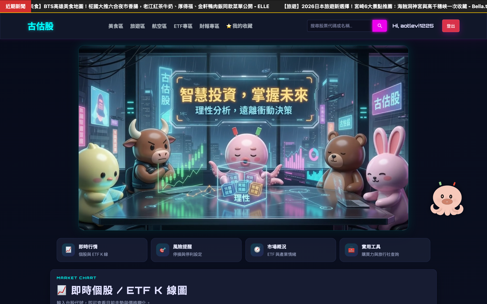
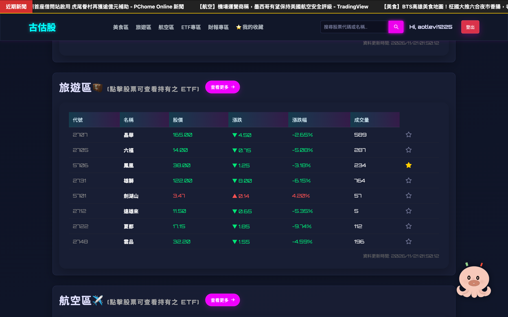
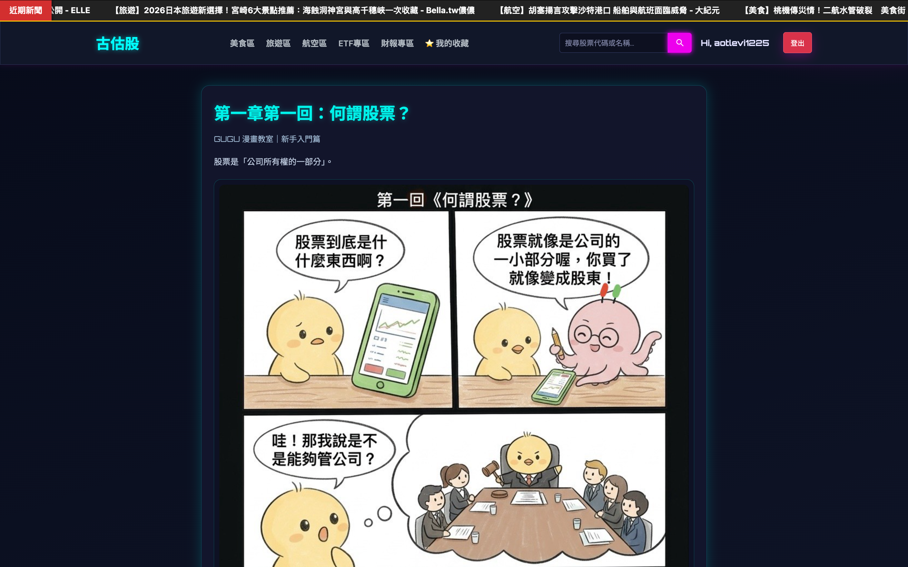

# 📈 古估股 GuGuGu
### 情境式漫畫輔助之股票資訊學習平台

古估股是一個結合**股票資訊查詢與情境式漫畫教學**的網站，主要針對股票初學者設計，希望讓使用者能以更輕鬆、容易理解的方式接觸股票市場。

平台以生活中常見的**美食、旅遊及航空產業**作為股票分類，提供相關個股與 ETF 資訊，並搭配漫畫故事介紹股票基礎知識，讓使用者能在學習的同時觀察實際市場行情。

---

## 🖥️ 網站展示

### 首頁



首頁整合股票資訊、ETF 行情及產業新聞，方便使用者快速瀏覽市場動態。

### 股票資訊與漫畫教學

| 股票資訊 | 情境式漫畫教學 |
|:---:|:---:|
|  |  |

---

## ✨ 主要功能

### 📊 股票資訊查詢

提供美食、旅遊及航空三大產業的股票資訊，並整合 ETF 行情。使用者可以透過產業分類或搜尋功能，查看感興趣的個股資訊。

### 📖 情境式漫畫教學

透過故事情境與角色對話介紹股票基礎知識，降低初學者理解專業術語的門檻，讓學習過程更有趣。

### 👤 會員系統

提供帳號註冊、登入、信箱驗證及忘記密碼功能，方便使用者管理個人帳號。

### ⭐ 股票收藏

登入後可將感興趣的股票加入收藏清單，方便日後查詢與追蹤。

### 🔔 股票提醒與通知

使用者可以設定股票價格條件或指定時間提醒，並透過站內通知及已驗證的 Email 接收提醒資訊。

### 📰 產業新聞

整合美食、旅遊及航空相關新聞，透過首頁跑馬燈呈現近期產業動態。

---

## 🛠️ 開發技術

| 類別 | 使用技術 |
|---|---|
| 網站開發 | **PHP** |
| 介面與互動 | HTML、CSS、JavaScript |
| 後端 API | Node.js、Express |
| 資料庫 | MySQL |
| 股票資料 | TWSE 市場資訊介面 |
| 新聞資料 | Google News RSS |
| 開發工具 | VS Code、XAMPP |
| 版本控制 | Git、GitHub |

---

## 📁 專案架構

```text
gugugu/
├── assets/          # 網站圖片與漫畫素材
├── backend/         # 後端 API
├── database/        # 資料庫結構
├── data/            # 股票分類資料
├── gugu_chapter/    # 漫畫教學章節
├── includes/        # PHP 共用元件
├── lists/           # 產業分類及收藏頁面
├── scripts/         # JavaScript 功能
├── styles/          # CSS 樣式
├── login.php        # 會員登入
├── main.php         # 網站首頁
├── stock-detail.php # 個股詳情
└── README.md
```

---

## 🚀 如何執行

本專案使用 PHP、Node.js 及 MySQL，需要搭配 XAMPP 執行。

1. 將專案放入 XAMPP 的 `htdocs/gugugu` 目錄。
2. 啟動 Apache 與 MySQL。
3. 依照 `.env.example` 設定本機環境變數。
4. 使用 `database/` 中的 SQL 腳本建立資料表。
5. 在專案目錄執行：

```bash
npm install
npm start
```

6. 開啟瀏覽器：

`http://localhost/gugugu/login.php`

> 本專案為動態網站，完整功能無法直接透過 GitHub Pages 執行。

---

## 📌 專題資訊

**專題名稱：** 古估股－情境式漫畫輔助之股票資訊學習平台

**學校：** 朝陽科技大學


**GitHub：** https://github.com/S1lver23/gugugu

本專題以股票資訊展示與基礎知識學習為目的，不構成投資建議。